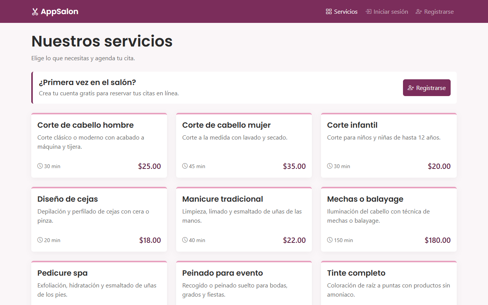

# ✂ AppSalon

## 1. Descripción

AppSalon es un sistema web para un salón de belleza. Los visitantes consultan el catálogo de servicios,
los clientes crean su cuenta, la confirman por correo y **reservan sus citas en un calendario**, eligiendo
varios servicios y una hora libre. Los administradores ven el **dashboard**, la **agenda** del día o la
semana, gestionan citas, usuarios, servicios y horarios, y otras aplicaciones pueden usar la **API REST**.

> **Estado:** Entrega Final (semana 16) completa: requerimientos 6 (citas), 7 (panel avanzado), 8 (API) y
> 9 (reportes y exportación), además de la recuperación de contraseña por correo.



## 2. Tecnologías

Versiones con las que se desarrolló y probó el proyecto:

| Capa | Tecnología | Versión |
|---|---|---|
| Lenguaje | PHP (`php -v`) | 8.4.27 (compatible desde 8.2, la versión de XAMPP) |
| Framework | Laravel (`php artisan --version`) | 12.70.2: Eloquent, Blade, Form Requests, Policies, middleware, Mail, API Resources |
| API | Laravel Sanctum | 4.x (tokens Bearer) |
| Reportes | barryvdh/laravel-dompdf (PDF) y Chart.js por CDN (gráficas) | dompdf 3.x, Chart.js 4.4.1 |
| Base de datos | MariaDB de XAMPP (`SELECT VERSION();`) | 10.4.32-MariaDB (compatible con MySQL 8) |
| Interfaz | Bootstrap y Bootstrap Icons por CDN, fuente Poppins | Bootstrap 5.3.3, Icons 1.11.3. No necesita Node ni Vite |
| Pruebas | PHPUnit | 11.5 (132 pruebas) |
| Herramientas | Composer, Git y GitHub, phpMyAdmin | Composer 2 |

## 3. Requisitos

- **XAMPP** con PHP 8.2 o superior y MySQL/MariaDB. Las extensiones `pdo_mysql`, `mbstring`, `openssl`
  y `fileinfo` ya vienen activas en XAMPP.
- **Composer 2** ([getcomposer.org](https://getcomposer.org/download/)). El instalador para Windows lo agrega al PATH.
- **Git**.

Antes de instalar, comprueba en una ventana nueva de PowerShell que los tres comandos responden:

```powershell
php -v
composer -V
git --version
```

Si alguno dice *"no se reconoce como nombre de un cmdlet"*, ese programa no está en el PATH. Reinstálalo con su
instalador oficial o agrega su carpeta a la variable de entorno `Path` (para PHP de XAMPP: `C:\xampp\php`).

## 4. Instalación (Windows con XAMPP)

Los comandos son para **PowerShell**. Si instalaste XAMPP en otra carpeta, cambia `C:\xampp` por la tuya.

1. **Clonar el repositorio** y entrar a la carpeta.
   ```powershell
   git clone https://github.com/Breiner321/AppSalon.git
   cd AppSalon
   ```
2. **Instalar las dependencias de PHP.**
   ```powershell
   composer install
   ```
3. **Crear el archivo de configuración** a partir del ejemplo y **generar la clave** de la aplicación.
   ```powershell
   Copy-Item .env.example .env
   php artisan key:generate
   ```
   Los valores del ejemplo ya sirven para XAMPP: base `appsalon_mvc_php`, usuario `root` sin contraseña,
   idioma `es` y correos escritos en el log (`MAIL_MAILER=log`).
4. **Encender MySQL** con el botón *Start* de la fila *MySQL* en el panel de control de XAMPP.
5. **Crear la base de datos** (también puedes hacerlo en phpMyAdmin con el cotejamiento `utf8mb4_unicode_ci`).
   ```powershell
   C:\xampp\mysql\bin\mysql.exe -u root -e "CREATE DATABASE appsalon_mvc_php CHARACTER SET utf8mb4 COLLATE utf8mb4_unicode_ci"
   ```
6. **Crear las tablas y cargar los datos de prueba.**
   ```powershell
   php artisan migrate --seed
   ```
7. **Levantar el servidor** y abrir **http://127.0.0.1:8000**.
   ```powershell
   php artisan serve
   ```

### Alternativa: importar el script SQL

En lugar de los pasos 5 y 6 puedes importar [`database/sql/appsalon_mvc_php.sql`](database/sql/appsalon_mvc_php.sql),
que crea la base `appsalon_mvc_php` con todas las tablas y los mismos datos de prueba:

- **phpMyAdmin:** pestaña *Importar* → elegir el archivo → *Continuar*.
- **Consola:** PowerShell no admite `<`, así que se usa `cmd`:
  ```powershell
  cmd /c "C:\xampp\mysql\bin\mysql.exe -u root < database\sql\appsalon_mvc_php.sql"
  ```

## 5. Credenciales de prueba

| Rol | Correo | Contraseña |
|---|---|---|
| Administrador | `admin@appsalon.com` | `Admin123` |
| Cliente | `cliente@appsalon.com` | `Cliente123` |
| Otros clientes | `camila.rodriguez@correo.com`, `andres.martinez@correo.com`, … | `Cliente123` |

Las crea `database/seeders/UserSeeder.php` y también vienen en el script SQL. Entre los otros clientes,
`julian.castro@correo.com` está sin confirmar y `paula.moreno@correo.com` está desactivada (sirven para probar
esos casos). Los datos de prueba incluyen el horario del salón, una fecha bloqueada y unas 150 citas de las
últimas seis semanas y las próximas tres.

**API:** `POST /api/login` con cualquiera de estas cuentas devuelve el token (ver [docs/api.md](docs/api.md)).
También puedes registrar clientes nuevos en `/registro` (ver [10. Confirmación de cuenta](#10-confirmación-de-cuenta)).

## 6. Funcionalidades por rol

### Visitante (sin sesión)
- **Catálogo** (`/` y `/servicios`): tarjetas con los servicios activos (nombre, descripción, duración y precio).
- **Registro** (`/registro`) validado en el servidor: nombre y apellido, correo válido y único de hasta 30 caracteres,
  contraseña de al menos 6 caracteres con confirmación y teléfono opcional de 10 dígitos.
- **Confirmación de cuenta** con el enlace que llega por correo (`/confirmar/{token}`).
- **Inicio de sesión** (`/login`). Si los datos son incorrectos, el mensaje no revela si el correo existe.
  Una cuenta sin confirmar no puede entrar.
- **Recuperar la contraseña** (`/olvide-contrasena`): llega un correo con un enlace que vence a los 60 minutos para
  elegir una contraseña nueva. Con `MAIL_MAILER=log` el enlace queda en `storage/logs/laravel.log`, como el de confirmación.

### Cliente
- Todo lo del visitante, con su nombre en el menú. Después del login va al catálogo, con botones **Reservar**.
- **Reservar cita** (`/citas/nueva`): elige uno o varios servicios, un día en el **calendario** (los días cerrados,
  bloqueados o pasados aparecen deshabilitados) y una de las **horas libres**, que se calculan según la duración
  total. El resumen muestra la duración y el total. Al reservar recibe un **correo** con el detalle.
- **Mis citas** (`/citas`): próximas citas con su estado e historial. Puede **modificar** (vuelve a quedar pendiente)
  o **cancelar** una cita pendiente o confirmada que todavía no empieza. Cada cambio le llega por correo.
- **Cierre de sesión**, que invalida la sesión.
- Si intenta entrar al panel de administración, ve la página **403 Acceso denegado**.

### Administrador
- **Dashboard** (`/admin`): citas de hoy, ingresos de hoy y del mes, clientes, citas pendientes de confirmar y la
  lista de citas del día. Después del login va aquí.
- **Agenda** (`/admin/agenda`): vista de día o de semana, con navegación y cambio de estado de cada cita
  (confirmar, completar, cancelar). Confirmar o cancelar le avisa al cliente por correo.
- **Citas** (`/admin/citas`): búsqueda por cliente y filtros por estado y rango de fechas.
- **Usuarios** (`/admin/usuarios`): búsqueda por nombre, correo o teléfono, filtros por rol y estado,
  **activar o desactivar** cuentas y **cambiar el rol**. Una cuenta desactivada no puede entrar ni usar la API.
- **CRUD de servicios** (`/admin/servicios`): listado paginado de 10 en 10, crear, editar, activar o desactivar
  (el servicio inactivo no sale en el catálogo) y eliminar con una ventana de confirmación.
- **Horarios** (`/admin/horarios`): horario de apertura y cierre de cada día y **fechas bloqueadas** (festivos, vacaciones).
- **Reportes** (`/admin/reportes`): citas por período (por estado y por día) e **ingresos por servicio y por día**, con
  **gráficas** (Chart.js), y exportación de cada reporte a **PDF** y a **Excel (CSV)**.

### API REST
- Login con token de **Laravel Sanctum**, `GET /api/servicios`, `GET /api/citas/usuario/{id}`, `POST /api/citas`,
  `PUT /api/citas/{id}`, cancelar y disponibilidad. Documentación con ejemplos en **[docs/api.md](docs/api.md)**.

### Reglas de la agenda
- El salón atiende **una cita a la vez**: no se permiten citas que se sobrepongan (las canceladas no cuentan).
- La cita debe quedar dentro del horario del día, reservarse con 60 minutos de anticipación como mínimo y
  hasta 60 días adelante. Las horas de inicio van cada 30 minutos. Se cambian en el `.env` (`SALON_*`).

### Para todos
- **Diseño responsive** revisado a 360, 768 y 1280 px ([docs/responsive.md](docs/responsive.md)).
- **Todo en español**, incluidos los mensajes de validación y las páginas de error 403, 404, 419, 429 y 500.
- **Mensajes** de éxito, error, aviso e información que se cierran solos.

## 7. Estructura de carpetas

```
app/
├── Http/Controllers/   AuthController, PasswordResetController, ServiceController, AppointmentController, AdminController
│   ├── Admin/          CitaController (agenda, filtros, estados), UsuarioController, HorarioController, ReporteController
│   └── Api/            AuthController (token), ServicioController, CitaController
├── Http/Middleware/    AdminMiddleware ('admin'), EnsureUserIsActive ('activo'), JsonSinEscaparUnicode
├── Http/Requests/      RegisterRequest, LoginRequest, ServiceRequest, AppointmentRequest
├── Http/Resources/     ServicioResource, CitaResource, UsuarioResource (JSON de la API)
├── Mail/               ConfirmarCuenta, CitaNotificacion, RestablecerContrasena
├── Models/             User, Service, Appointment, AppointmentService (pivote), Horario, Bloqueo
├── Policies/           AppointmentPolicy (dueño de la cita o admin)
├── Services/           Disponibilidad (reglas de la agenda), ReservaCitas (crear, modificar, cancelar), Reportes
└── Support/            HandlesDatabaseErrors (escrituras seguras con runSafely)
bootstrap/app.php       rutas web y api, alias de middleware, errores JSON de la API
config/salon.php        reglas de la agenda (intervalo, anticipación, días máximos)
database/
├── factories/          UserFactory, ServiceFactory
├── migrations/         usuarios, servicios, citas, citasServicios y tablas de Laravel
├── seeders/            UserSeeder, ServiceSeeder, HorarioSeeder, AppointmentSeeder
└── sql/                appsalon_mvc_php.sql (script completo: estructura y datos)
docs/                   documentación (manual PDF, seguridad, checklist, revisiones, capturas)
lang/es/                validación, autenticación, contraseñas y paginación en español
public/css/app.css      estilos propios sobre Bootstrap
resources/views/
├── layouts/            layout principal con la navegación por rol
├── components/         <x-alert />, <x-form-error />
├── auth/               registro, login y recuperación de contraseña
├── services/           catálogo público
├── appointments/       reservar/modificar (calendario) y mis citas
├── admin/              dashboard, agenda, citas, usuarios, horarios, reportes (y sus PDF) y CRUD de servicios
├── emails/             confirmación de cuenta y avisos de cita
└── errors/             403, 404, 419, 429, 500, 4xx y 5xx
routes/web.php          rutas web (los nombres de ruta son el contrato del equipo)
routes/api.php          rutas de la API REST
tests/Feature/          pruebas de autenticación, seguridad, servicios, interfaz, citas, panel, horarios y API
.env.example            archivo de configuración de ejemplo (sin contraseñas)
```

### Base de datos

| Tabla | Campos principales |
|---|---|
| `usuarios` | id, nombre, apellido, email (único), password, telefono, admin, confirmado, token |
| `servicios` | id, nombre, precio, descripcion, duracion, activo |
| `citas` | id, fecha, hora, duracion, usuarioId → usuarios, total, estado |
| `citasServicios` | id, citaId → citas, servicioId → servicios, precio (al reservar) |
| `horarios` | id, diaSemana (0 domingo … 6 sábado, único), apertura, cierre, abierto |
| `bloqueos` | id, fecha (única), motivo |
| `personal_access_tokens` | tokens de la API (Sanctum) |

`usuarios` tiene además la columna `activo`. El diagrama entidad-relación está en el
[manual técnico](docs/manual-tecnico.md#2-diagrama-de-base-de-datos).

Si se borra un usuario, sus citas quedan con `usuarioId` en NULL. Si se borra una cita o un servicio, sus filas
de `citasServicios` se borran en cascada.

## 8. Seguridad

- Contraseñas con **bcrypt**. `password` y `token` nunca salen al serializar un usuario.
- **Validación en el servidor** con Form Requests. Solo se guardan los campos validados.
- **XSS:** todas las vistas imprimen con `{{ }}`.
- **CSRF:** todos los formularios llevan `@csrf`. Sin token, la respuesta es 419.
- **Sesiones:** se regeneran al entrar y se invalidan al salir. Cookie `http_only`, `same_site=lax`, 120 minutos.
- **Permisos:** el middleware `admin` protege `/admin` y todo el CRUD de servicios. Un cliente recibe 403.
- **Límite de intentos:** 5 por minuto en el login y en el registro. Al sexto se responde 429.
- **Consultas** con Eloquent (prepared statements), sin SQL concatenado.
- **Citas:** solo el dueño o un admin pueden verlas o cambiarlas (`AppointmentPolicy`). La disponibilidad se revisa
  otra vez dentro de una transacción con bloqueo de filas, para evitar dobles reservas simultáneas.
- **API:** tokens de Sanctum guardados como hash, con vencimiento de 24 h; login limitado a 5 intentos por minuto.
  Las cuentas desactivadas no pueden entrar ni usar sus tokens.

El detalle de cada requisito, con su archivo y su prueba, está en **[docs/seguridad.md](docs/seguridad.md)**.
La revisión del CRUD está en [docs/revision-A10.md](docs/revision-A10.md).

## 9. Tests

Las pruebas usan una base aparte, `appsalon_mvc_php_test` (ver `phpunit.xml`), que se vacía en cada prueba.
Créala una vez y corre las pruebas con MySQL encendido:

```powershell
C:\xampp\mysql\bin\mysql.exe -u root -e "CREATE DATABASE appsalon_mvc_php_test CHARACTER SET utf8mb4 COLLATE utf8mb4_unicode_ci"
php artisan test
```

Resultado esperado: **132 pruebas en verde**. Cubren registro, login y logout, confirmación por token, permisos,
CSRF, throttle, XSS, integridad referencial, CRUD de servicios, catálogo, navegación, interfaz e idioma, y en la
Entrega Final la reserva de citas (sobreposición, horario, bloqueos, modificar, cancelar, correos), el panel
(dashboard, agenda, filtros, usuarios, horarios), la API, los reportes con su exportación y la recuperación de contraseña.

## 10. Confirmación de cuenta

Al registrarse, la cuenta queda sin confirmar y se envía un correo con un enlace único:
`http://127.0.0.1:8000/confirmar/{token}`. El token tiene 15 caracteres. Hasta abrir ese enlace, el cliente no puede iniciar sesión.

En el entorno local no se envían correos de verdad (`MAIL_MAILER=log`): el correo completo queda escrito al final
de `storage/logs/laravel.log`. Para obtener el enlace del último registro:

```powershell
Select-String -Path storage\logs\laravel.log -Pattern 'http\S*/confirmar/\w+' | Select-Object -Last 1 | ForEach-Object { $_.Matches.Value }
```

Copia el enlace en el navegador. Verás "Cuenta confirmada" y ya podrás iniciar sesión.
Cada enlace sirve una sola vez. Si el token no existe, se muestra "Token no válido".

## 11. Equipo y reparto de tareas

El proyecto lo desarrollaron 2 personas. Cada tarea tiene su rama `feature/<ID>-<tema>`, su commit con el ID y su merge `--no-ff` a `develop`.

| Integrante | Rol | Tareas |
|---|---|---|
| Dev 1 | Backend, seguridad y entrega | T1 proyecto base, T2 migraciones, T3 modelos, A1 rutas, A2 Form Requests, A3 registro, T4 seeders, T5 manejo de errores, A4 login y sesiones, A5 middleware admin, A6 auditoría de seguridad, A7 confirmación por token, A8 tests de autenticación, A10 revisión del CRUD, T6b checklist, T6c script SQL, T7 README |
| Dev 2 | Interfaz, servicios y documentación | U1 guía visual, U2 layout, U3 alertas y errores de formulario, U4 catálogo, U5–U6 CRUD de servicios, U7 navegación y panel, U8 responsive, U9 pulido, U10 capturas, A9 idioma, T6a revisión cruzada, T8 manual, T9 primera versión del README y del SQL |

## 12. Manual de usuario

**[Manual de usuario (PDF, 5 páginas)](docs/manual/Manual-de-usuario-AppSalon.pdf)**: guía para clientes (cuenta, reserva y gestión de citas)
y administradores (panel, agenda, citas, usuarios, servicios y horarios).

Otra documentación:

| Documento | Contenido |
|---|---|
| **[docs/manual-tecnico.md](docs/manual-tecnico.md)** | **Manual técnico: arquitectura, diagrama de base de datos, reglas de la agenda, seguridad y pruebas** |
| **[docs/api.md](docs/api.md)** | **Documentación de la API REST con ejemplos** |
| [docs/checklist-entrega-final.md](docs/checklist-entrega-final.md) | Requisitos de la Entrega Final con su evidencia |
| [docs/checklist-entrega-intermedia.md](docs/checklist-entrega-intermedia.md) | Requisitos de la rúbrica con su evidencia |
| [docs/seguridad.md](docs/seguridad.md) | Cada requisito de seguridad, cómo se cumple y qué prueba lo verifica |
| [docs/convenciones.md](docs/convenciones.md) | Convenciones del backend (`runSafely`, páginas de error) |
| [docs/guia-visual.md](docs/guia-visual.md) | Paleta, tipografía, componentes y bocetos |
| [docs/responsive.md](docs/responsive.md) | Revisión a 360, 768 y 1280 px |
| [docs/revision-T6a.md](docs/revision-T6a.md) y [docs/revision-A10.md](docs/revision-A10.md) | Revisiones cruzadas de código |

### Regenerar el script SQL

Después de cambiar las migraciones o los seeders:

```powershell
php artisan migrate:fresh --seed
C:\xampp\mysql\bin\mysqldump.exe -u root --routines --databases appsalon_mvc_php --result-file=database\sql\appsalon_mvc_php.sql
```

No uses `>` en PowerShell, porque guarda el archivo en UTF-16. En Windows, MariaDB escribe `citasservicios` en minúsculas.
Cámbialo a `citasServicios` en el script para que también funcione en servidores Linux, y vuelve a poner la cabecera
con las instrucciones y las credenciales.

## 13. Pendientes

- Confirmar con el profesor la unidad del precio (observación abierta del
  [checklist de la Entrega Intermedia](docs/checklist-entrega-intermedia.md)) y las demás observaciones de
  [docs/revision-A10.md](docs/revision-A10.md).
- Reenvío del correo de confirmación de cuenta (mejora opcional; hoy se puede usar *¿Olvidaste tu contraseña?*,
  que también confirma la cuenta).
