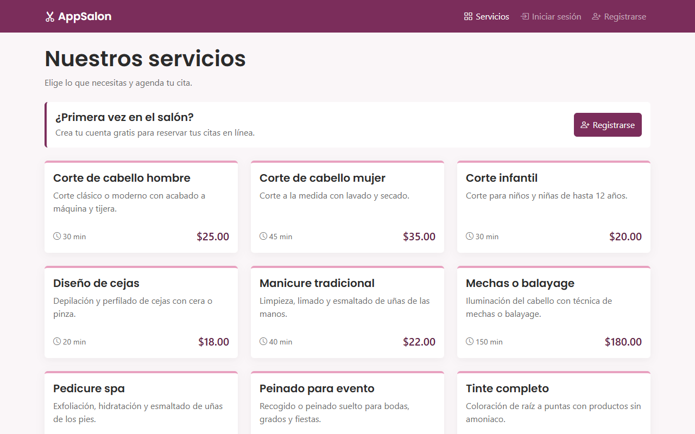

# ✂ AppSalon

Sistema web de gestión de citas para un salón de belleza. Los visitantes consultan el catálogo de servicios,
los clientes se registran e inician sesión y los administradores gestionan los servicios del salón.

> **Estado:** entrega intermedia (semana 11). La reserva de citas, la API, los reportes y la confirmación
> por correo corresponden a la entrega final (semana 16). Ver [Pendiente para la entrega final](#pendiente-para-la-entrega-final).



## Funcionalidades implementadas

### Autenticación y seguridad
- **Registro de clientes** con validación en el servidor: nombre y apellido obligatorios, correo válido y único,
  contraseña de al menos 6 caracteres con confirmación y teléfono opcional de 10 dígitos.
- **Inicio y cierre de sesión.** El inicio regenera la sesión y el cierre la invalida y regenera el token CSRF.
  Cada rol llega a su página: el administrador al panel y el cliente al catálogo.
- **Contraseñas con bcrypt**, nunca en texto plano.
- **Roles:** el middleware `admin` protege `/admin` y todo el CRUD de servicios; un cliente recibe 403.
- **Protección CSRF** en todos los formularios y **escape XSS** con `{{ }}` en todas las vistas.
- **Límite de intentos:** 5 por minuto en el login y en el registro; al sexto se responde 429.
- Detalle de cada requisito y su prueba en [docs/seguridad.md](docs/seguridad.md).

### Servicios
- **Catálogo público** (`/` y `/servicios`) con tarjetas de los servicios activos: nombre, descripción, duración y precio.
- **CRUD de servicios para administradores** (`/admin/servicios`): listado paginado, crear, editar,
  activar o desactivar y eliminar con una ventana de confirmación.
- **Validación** con `ServiceRequest`: nombre de hasta 60 caracteres, precio de 0 a 999.99, duración de 10 a 480 minutos
  y descripción de hasta 500 caracteres.

### Administración
- **Panel** (`/admin`) con el número de servicios activos, servicios inactivos y usuarios registrados, y accesos rápidos.

### Interfaz
- **Diseño responsive** revisado a 360, 768 y 1280 px: sin scroll horizontal y con botones de al menos 44 px.
  En el celular, el listado del panel se ve en tarjetas ([docs/responsive.md](docs/responsive.md)).
- **Navegación por rol:** el menú cambia para invitados, clientes y administradores, y marca la página activa.
- **Validación visual:** campos en rojo con su mensaje, asterisco en los obligatorios y datos conservados al fallar.
- **Mensajes de estado** verdes, rojos o azules que se cierran solos a los 5 segundos.
- **Todo en español**, incluidas las 109 reglas de validación y las páginas de error 403, 404, 419, 429, 500 y genéricas.

### Base de datos
- Tablas `usuarios`, `servicios`, `citas` y `citasServicios` con claves foráneas e integridad referencial.
  Si se borra un usuario, sus citas quedan con `usuarioId` en NULL; si se borra una cita o un servicio, sus filas
  de `citasServicios` se borran en cascada.
- Datos de prueba: 2 usuarios, 10 servicios y 2 citas con sus servicios.

## Tecnologías

| Capa | Tecnología |
|---|---|
| Lenguaje y framework | PHP 8.2+ y **Laravel 12** (Eloquent, Blade, Form Requests, middleware) |
| Base de datos | **MySQL / MariaDB** (XAMPP) |
| Interfaz | **Bootstrap 5.3** y Bootstrap Icons por CDN, fuente Poppins. Sin Node ni Vite |
| Pruebas | PHPUnit 11 (54 pruebas de funcionalidad) |
| Herramientas | Composer, Git y GitHub, phpMyAdmin |

## Requisitos

- **XAMPP** con PHP 8.2 o superior y MySQL/MariaDB, con las extensiones `pdo_mysql`, `mbstring`, `openssl` y `fileinfo`
  (vienen activas en XAMPP).
- **Composer** 2.
- **Git**.

## Instalación

1. **Clonar el repositorio**
   ```bash
   git clone https://github.com/Breiner321/AppSalon.git
   cd AppSalon
   ```
2. **Instalar las dependencias de PHP**
   ```bash
   composer install
   ```
3. **Crear el archivo de configuración** a partir del ejemplo y generar la clave de la aplicación
   ```bash
   cp .env.example .env
   php artisan key:generate
   ```
   En Windows (PowerShell) usa `Copy-Item .env.example .env`. Los valores por defecto ya sirven para XAMPP:
   base `appsalon_mvc_php`, usuario `root` sin contraseña, idioma `es`.
4. **Iniciar MySQL** desde el panel de control de XAMPP.
5. **Crear la base de datos con los datos de prueba.** Elige una de las dos opciones:
   - **Con Laravel (recomendado):** crea la base vacía y corre las migraciones con los seeders.
     ```bash
     C:\xampp\mysql\bin\mysql.exe -u root -e "CREATE DATABASE appsalon_mvc_php CHARACTER SET utf8mb4 COLLATE utf8mb4_unicode_ci"
     php artisan migrate --seed
     ```
     También puedes crear la base desde phpMyAdmin.
   - **Con el script SQL:** importa [`database/appsalon_mvc_php.sql`](database/appsalon_mvc_php.sql) desde phpMyAdmin
     (pestaña *Importar*) o con
     `C:\xampp\mysql\bin\mysql.exe -u root < database/appsalon_mvc_php.sql`.
     El script borra y vuelve a crear la base.
6. **Levantar el servidor**
   ```bash
   php artisan serve
   ```
   Abre **http://127.0.0.1:8000**.

## Usuarios de prueba

| Rol | Correo | Contraseña |
|---|---|---|
| Administrador | `admin@appsalon.com` | `Admin123` |
| Cliente | `cliente@appsalon.com` | `Cliente123` |

Los crea `database/seeders/UserSeeder.php` y también vienen en el script SQL. También puedes registrar clientes nuevos en `/registro`.

## Pruebas

Las pruebas usan una base aparte, `appsalon_mvc_php_test` (ver `phpunit.xml`). Créala una vez y corre las pruebas:

```bash
C:\xampp\mysql\bin\mysql.exe -u root -e "CREATE DATABASE appsalon_mvc_php_test CHARACTER SET utf8mb4 COLLATE utf8mb4_unicode_ci"
php artisan test
```

Herramientas de revisión de la interfaz (requieren el servidor corriendo y Chrome instalado):

```bash
node docs/capturas/herramienta/auditar-responsive.mjs
node docs/capturas/herramienta/buscar-ingles.mjs
```

## Base de datos

| Tabla | Campos principales |
|---|---|
| `usuarios` | id, nombre, apellido, email (único), password, telefono, admin, confirmado, token |
| `servicios` | id, nombre, precio, descripcion, duracion, activo |
| `citas` | id, fecha, hora, usuarioId → usuarios, total, estado |
| `citasServicios` | id, citaId → citas, servicioId → servicios |

La base se define en las migraciones (`database/migrations`) y los datos de prueba en los seeders (`database/seeders`).
El script `database/appsalon_mvc_php.sql` es un volcado de esa misma base. Para regenerarlo después de cambiar
las migraciones:

```bash
php artisan migrate:fresh --seed
C:\xampp\mysql\bin\mysqldump.exe -u root --databases appsalon_mvc_php > database/appsalon_mvc_php.sql
```

> En Windows, MariaDB guarda los nombres de tabla en minúsculas (`citasservicios`). El script del repositorio usa
> `citasServicios`, como el modelo, para que funcione también en servidores Linux. Si lo regeneras, corrige ese nombre.

## Estructura del proyecto

```
app/
├── Http/Controllers/   AuthController, ServiceController, AdminController, AppointmentController
├── Http/Middleware/    AdminMiddleware (alias 'admin')
├── Http/Requests/      RegisterRequest, LoginRequest, ServiceRequest
├── Models/             User, Service, Appointment, AppointmentService
└── Support/            HandlesDatabaseErrors (escrituras seguras con runSafely)
database/
├── migrations/         tablas del proyecto y de Laravel
├── seeders/            UserSeeder, ServiceSeeder, AppointmentSeeder
└── appsalon_mvc_php.sql
resources/views/
├── layouts/            layout principal con la navegación por rol
├── components/         <x-alert />, <x-form-error />
├── auth/               registro y login
├── services/           catálogo público
├── admin/              panel y CRUD de servicios
└── errors/             403, 404, 419, 429, 500, 4xx y 5xx
lang/es/                validación, autenticación, contraseñas y paginación en español
routes/web.php          rutas web (nombres de ruta = contrato del equipo)
public/css/app.css      estilos propios sobre Bootstrap
tests/Feature/          pruebas de registro, login, seguridad, servicios, navegación e interfaz
docs/                   documentación del proyecto (ver abajo)
```

## Documentación

| Documento | Contenido |
|---|---|
| [Manual de usuario (PDF)](docs/manual/Manual-de-usuario-AppSalon.pdf) | Guía de 5 páginas para clientes y administradores |
| [docs/seguridad.md](docs/seguridad.md) | Cada requisito de seguridad, cómo se cumple y qué prueba lo verifica |
| [docs/convenciones.md](docs/convenciones.md) | Convenciones del backend (`runSafely`, páginas de error) |
| [docs/guia-visual.md](docs/guia-visual.md) | Paleta, tipografía, componentes y bocetos de pantallas |
| [docs/responsive.md](docs/responsive.md) | Revisión a 360, 768 y 1280 px y checklist manual |
| [docs/capturas/LISTA.md](docs/capturas/LISTA.md) | Capturas de pantalla usadas en el manual |
| [docs/revision-T6a.md](docs/revision-T6a.md) | Revisión cruzada de código entre los desarrolladores |

## Pendiente para la entrega final

- Reserva de citas con calendario, selección de varios servicios y validación de disponibilidad.
- Confirmación de cuenta por correo y recuperación de contraseña.
- Panel avanzado: estadísticas, gestión de usuarios y agenda.
- API REST (`/api/servicios`, `/api/citas`…) con autenticación por token.
- Reportes con gráficas y exportación a PDF y Excel/CSV.

## Flujo de trabajo

Una rama por tarea (`feature/<código>-<tema>`), pruebas en verde antes de cada commit y merge `--no-ff` a `develop`.
