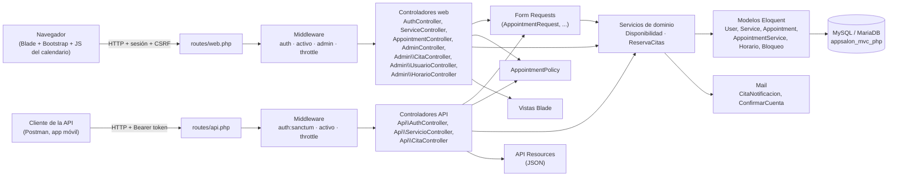
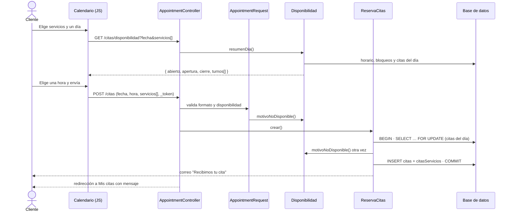
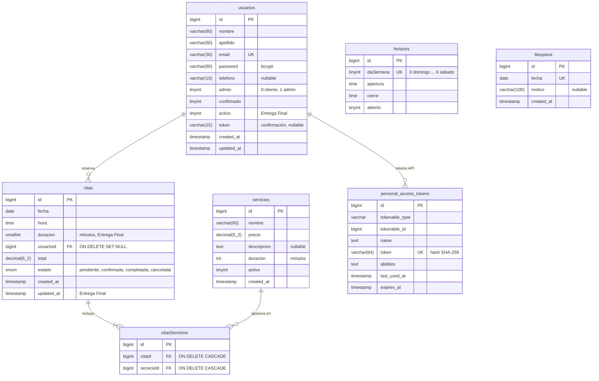
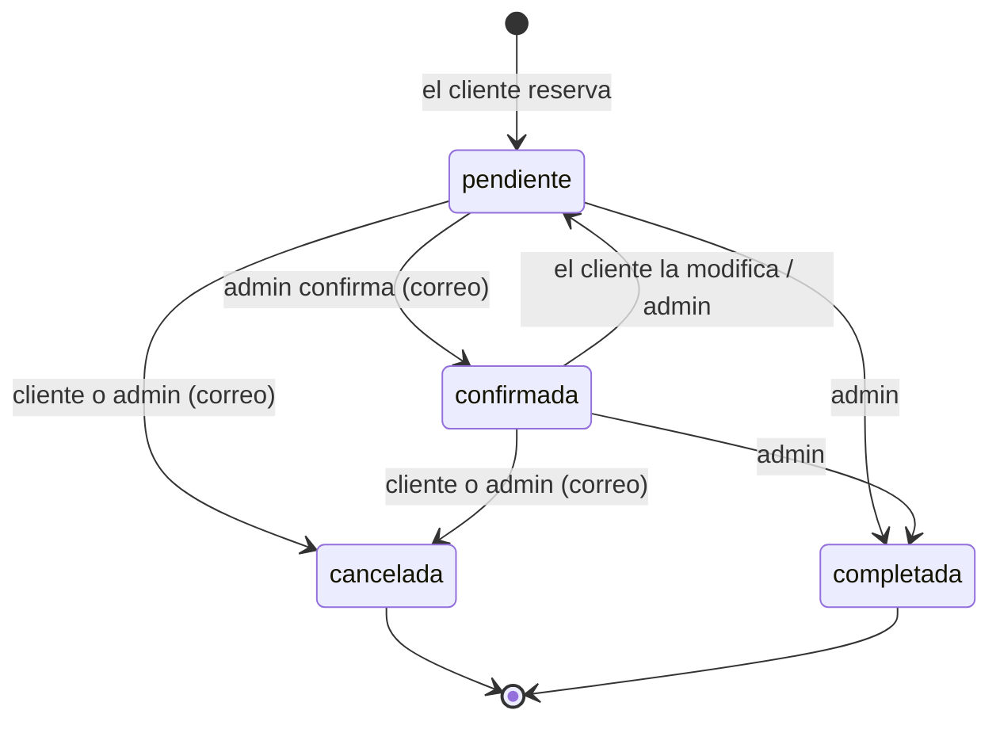

# Manual técnico · AppSalon

Documento técnico de la Entrega Final: arquitectura, base de datos, reglas de negocio de las citas,
seguridad y pruebas. La API tiene su propio documento: **[docs/api.md](api.md)**.

## 1. Arquitectura del sistema

AppSalon es una aplicación **Laravel 12** con el patrón **Modelo-Vista-Controlador**, vistas **Blade**
con Bootstrap 5 y base de datos **MySQL/MariaDB**. Tiene dos puertas de entrada que comparten la misma
lógica de negocio: la **web** (sesiones y cookies) y la **API REST** (tokens de Laravel Sanctum).



### Capas

| Capa | Carpeta | Responsabilidad |
|---|---|---|
| Rutas | `routes/web.php`, `routes/api.php` | URL, verbo HTTP, nombre de ruta y middleware de cada acción |
| Middleware | `app/Http/Middleware` | `AdminMiddleware` (solo admin, alias `admin`), `EnsureUserIsActive` (saca a cuentas desactivadas, alias `activo`), `JsonSinEscaparUnicode` (acentos legibles en la API) |
| Controladores | `app/Http/Controllers` | Reciben la petición, llaman a validación, permisos y servicios, y devuelven una vista, una redirección o JSON. No contienen reglas de negocio |
| Validación | `app/Http/Requests` | `RegisterRequest`, `LoginRequest`, `ServiceRequest` y `AppointmentRequest` (formato + disponibilidad) |
| Permisos | `app/Policies/AppointmentPolicy.php` | Una cita solo la ve, modifica o cancela su dueño o un administrador |
| Servicios de dominio | `app/Services` | `Disponibilidad` (horario, bloqueos, sobreposición, horas libres) y `ReservaCitas` (crear, modificar, cancelar, cambiar estado y avisar por correo) |
| Modelos | `app/Models` | Tablas, relaciones, conversiones de tipo y ayudas (`Appointment::puedeModificarse()`, `Horario::aMinutos()`) |
| Respuestas JSON | `app/Http/Resources` | Forma fija del JSON de la API (`ServicioResource`, `CitaResource`, `UsuarioResource`) |
| Correos | `app/Mail`, `resources/views/emails` | Confirmación de cuenta y avisos de cita |
| Vistas | `resources/views` | Blade: `layouts`, `auth`, `services`, `appointments`, `admin`, `emails`, `errors` |
| Configuración | `config/salon.php`, `config/sanctum.php` | Reglas ajustables de la agenda y duración de los tokens |

### Flujo de una reserva



La disponibilidad se revisa **dos veces**: en el Form Request (para mostrar el error junto al campo) y
dentro de la transacción con las citas del día bloqueadas (`lockForUpdate`), para que dos personas que
reservan al mismo tiempo no se queden con el mismo horario.

## 2. Diagrama de base de datos



### Cambios de la Entrega Final

| Migración | Cambio | Para qué |
|---|---|---|
| `2026_11_20_000001_add_activo_to_usuarios_table` | `usuarios.activo` | Activar o desactivar cuentas desde el panel |
| `2026_11_20_000002_add_duracion_to_citas_table` | `citas.duracion`, `citas.updated_at`, índice `(fecha, estado)` | Validar la sobreposición sin recalcular la duración de los servicios y consultar la agenda rápido |
| `2026_11_20_000003_create_horarios_table` | Tablas `horarios` y `bloqueos` | Gestión de horarios y disponibilidad del salón |
| `2026_11_20_000004_create_personal_access_tokens_table` | Tabla de Sanctum | Tokens de la API |

`citas.duracion` se guarda al reservar: si después se edita la duración de un servicio, las citas ya
reservadas no cambian. El script completo con datos está en
[`database/sql/appsalon_mvc_php.sql`](../database/sql/appsalon_mvc_php.sql).

### Integridad referencial

- Borrar un usuario deja sus citas con `usuarioId = NULL` (se conserva el historial y los ingresos).
- Borrar una cita o un servicio borra sus filas de `citasServicios` en cascada.
- `usuarios.email`, `horarios.diaSemana`, `bloqueos.fecha` y `personal_access_tokens.token` son únicos.

## 3. Reglas de negocio de las citas

Están en `app/Services/Disponibilidad.php` y se configuran en `config/salon.php` (o con variables del `.env`).

| Regla | Valor por defecto | Variable |
|---|---|---|
| El salón atiende **una cita a la vez**: dos citas no canceladas no se pueden sobreponer | — | — |
| Las horas de inicio van cada | 30 minutos | `SALON_INTERVALO_MINUTOS` |
| Anticipación mínima para reservar o modificar | 60 minutos | `SALON_ANTICIPACION_MINUTOS` |
| Hasta cuántos días adelante se puede reservar | 60 días | `SALON_DIAS_MAXIMOS` |
| Horario semanal y fechas bloqueadas | L–V 9:00–19:00, S 9:00–15:00, D cerrado | Panel → Horarios |

- Una cita ocupa el intervalo `[hora, hora + duración)`. Una cita de 10:00 a 10:45 y otra que empieza a
  las 10:45 **no** se sobreponen. Dos intervalos `[a, b)` y `[c, d)` se sobreponen si `a < d` y `c < b`.
- La cita completa debe quedar dentro del horario del día (termina a más tardar a la hora de cierre).
- Duración de la cita = suma de la duración de sus servicios; total = suma de sus precios.
- Las citas **canceladas** liberan su horario.
- Al modificar una cita, su propio horario cuenta como libre, y la cita vuelve a **pendiente**.

### Estados de una cita



El cliente solo puede modificar o cancelar citas **pendientes o confirmadas que todavía no empiezan**
(`Appointment::puedeModificarse()`). Las transiciones del administrador están en
`Admin\CitaController::TRANSICIONES`; completada y cancelada son estados finales.

### Notificaciones por correo

`App\Mail\CitaNotificacion` se envía al cliente cuando su cita se **reserva**, se **modifica**, el salón
la **confirma** o se **cancela**. Con `MAIL_MAILER=log` (valor del `.env.example`) los correos quedan en
`storage/logs/laravel.log`. Para enviarlos de verdad basta configurar SMTP en el `.env`
(`MAIL_MAILER=smtp`, `MAIL_HOST`, `MAIL_PORT`, `MAIL_USERNAME`, `MAIL_PASSWORD`). Si el envío falla, la
cita igual se guarda y el error se registra en el log.

## 4. Panel de administración

| Pantalla | Ruta | Qué hace |
|---|---|---|
| Dashboard | `/admin` | Citas de hoy, ingresos de hoy (completadas) y esperados, ingresos del mes, clientes y nuevos del mes, citas pendientes de confirmar, lista de citas de hoy |
| Agenda | `/admin/agenda?vista=dia\|semana&fecha=AAAA-MM-DD` | Citas del día o de la semana (lunes a domingo), navegación anterior/hoy/siguiente, cambio de estado en línea |
| Citas | `/admin/citas?q=&estado=&desde=&hasta=` | Búsqueda por cliente (nombre, apellido, nombre completo o correo), filtros por estado y rango de fechas, paginado de 15 |
| Usuarios | `/admin/usuarios?q=&rol=&estado=` | Búsqueda por nombre, correo o teléfono; filtros por rol (cliente/admin) y estado (activo/inactivo/sin confirmar); activar o desactivar y cambiar el rol |
| Servicios | `/admin/servicios` | CRUD de la Entrega Intermedia |
| Horarios | `/admin/horarios` | Horario de cada día de la semana y fechas bloqueadas |

Protecciones: un administrador no puede desactivarse ni quitarse el rol a sí mismo. Desactivar una
cuenta borra sus tokens de la API, y si tenía la sesión abierta, el middleware `activo` la cierra en su
siguiente petición.

## 5. Seguridad

Lo de la Entrega Intermedia sigue igual (bcrypt, Form Requests, `{{ }}` contra XSS, `@csrf`, sesiones
regeneradas, middleware `admin`, throttle, Eloquent con prepared statements; ver
[seguridad.md](seguridad.md)). En la Entrega Final se agregó:

| Riesgo | Medida | Dónde |
|---|---|---|
| Ver o cambiar citas ajenas (IDOR) | `AppointmentPolicy` en la web y en la API; `GET /api/citas/usuario/{id}` solo para el dueño o un admin | `app/Policies`, `Api\CitaController::porUsuario` |
| Doble reserva simultánea | Revisión de disponibilidad dentro de una transacción con `SELECT … FOR UPDATE` | `ReservaCitas::asegurarDisponible` |
| Datos de citas manipulados | Fecha, hora y servicios validados en el servidor; total y duración calculados en el servidor, nunca enviados por el cliente | `AppointmentRequest`, `ReservaCitas` |
| Tokens robados | Solo se guarda el hash SHA-256; expiran a las 24 h (`SANCTUM_EXPIRATION`); `POST /api/logout` los revoca; desactivar la cuenta los borra | Sanctum, `config/sanctum.php` |
| Fuerza bruta en la API | `POST /api/login` limitado a 5 intentos por minuto; demás rutas 60 por minuto | `routes/api.php` |
| Cuentas desactivadas | No pueden entrar por la web ni por la API, y se les cierra la sesión abierta | `EnsureUserIsActive`, `AuthController` |
| Filtración de datos | `password` y `token` ocultos en el modelo y fuera de `UsuarioResource` | `User::$hidden`, `UsuarioResource` |
| Mensajes de error con detalles internos | Errores de la API con `{"message": "..."}` en español; detalles solo en el log | `bootstrap/app.php` |

## 6. Pruebas

```powershell
php artisan test
```

**116 pruebas** (72 de la Entrega Intermedia + 44 nuevas) contra la base `appsalon_mvc_php_test`. Las
nuevas fijan "hoy" en el lunes 7 de diciembre de 2026 (`tests/Concerns/PreparaAgenda.php`) para que el
resultado no dependa del día en que se corren.

| Archivo | Qué prueba |
|---|---|
| `CitaReservaTest` | Calendario, reserva con varios servicios, total y duración, sobreposición (incluido el caso de citas contiguas), horario, domingo cerrado, fecha bloqueada, anticipación, servicios inválidos, disponibilidad JSON, modificar, cancelar, permisos y correos |
| `AdminCitasTest` | Dashboard (citas de hoy, ingresos, clientes), agenda de día y semana, búsqueda y filtros, cambio de estado con correo y transiciones no permitidas |
| `AdminUsuariosTest` | Búsqueda y filtros, activar/desactivar (login bloqueado, tokens borrados, sesión cerrada), cambio de rol y protección del propio admin |
| `HorariosTest` | Edición del horario semanal y su efecto en la disponibilidad, validación apertura/cierre, bloqueos |
| `ApiTest` | Login y token, 401/403/404/405/409/422 en JSON, los endpoints de servicios y citas, permisos por usuario, logout y cuentas desactivadas |

## 7. Despliegue

El sistema corre en local con XAMPP siguiendo el [README](../README.md#4-instalación-windows-con-xampp).
Para un servidor:

1. `composer install --no-dev --optimize-autoloader`
2. `.env` con `APP_ENV=production`, `APP_DEBUG=false`, la URL real en `APP_URL`, la base de datos y SMTP.
3. `php artisan key:generate`, `php artisan migrate --seed --force` (o importar el script SQL).
4. `php artisan config:cache && php artisan route:cache && php artisan view:cache`
5. El servidor web apunta a la carpeta `public/`. `storage/` y `bootstrap/cache/` deben poder escribirse.
